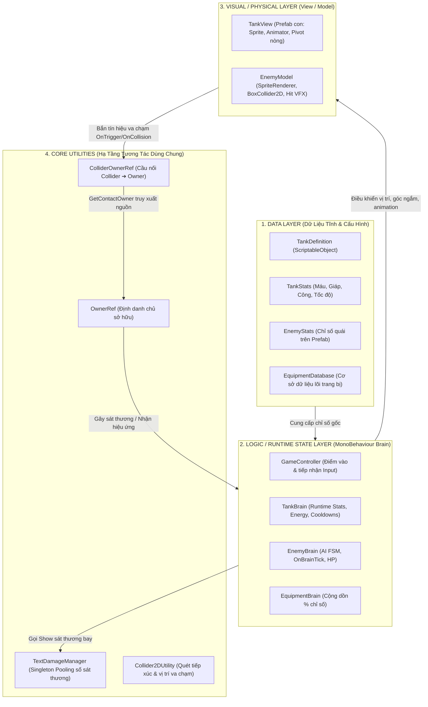
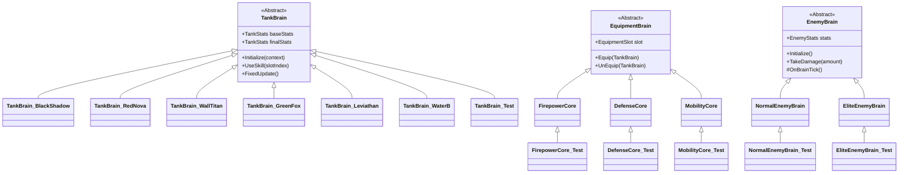

# Iron Wasteland — Tổng Quan Dự Án Toàn Diện (Project Overview)

> **Tài liệu đặc tả kiến trúc và cấu trúc toàn diện của dự án Iron Wasteland.**  
> Được trích xuất, phân tích và chuẩn hóa trực tiếp từ Đồ thị Tri thức Kiến trúc ([`knowledge-graph.json`](file:///d:/GameUnity/IronWasteland/.ua/knowledge-graph.json)) của Understand-Anything.

---

## 1. Thông Tin Chung (Project Metadata)

* **Tên dự án:** `IronWasteland`
* **Thể loại:** Game hành động bắn súng xe tăng 2D (Top-Down Action Shooter), hỗ trợ cả chế độ Chơi Đơn (Solo) và Hợp Tác Trực Tuyến (Co-op 2–4 người).
* **Nền tảng & Engine:** **Unity 6** (6000.x), **Universal Render Pipeline (URP)**, **Unity 2D**.
* **Hệ thống điều khiển:** **Unity Input System** (`InputSystem_Actions.inputactions`).
* **Hạ tầng kiểm thử:** **Unity Test Framework** (tích hợp sẵn test suite cho từng Brain và Core).
* **Kiến trúc cốt lõi:** Phân tách nghiêm ngặt 3 lớp: **Data (ScriptableObject) – Logic / Runtime State (Brain) – Visual / Physical (View / Model)** kết hợp tối ưu bộ nhớ bằng cơ chế **Object Pooling**.
* **Ngôn ngữ:** C# (.NET Standard), HLSL / CGINC (TextMesh Pro & Custom Shaders).
* **Quy mô phân tích:** 156 nodes (75 files mã nguồn, 39 classes, 34 functions, 5 documents, 3 config files) với 218 liên kết phụ thuộc (dependencies, inheritance, calls, tests).

> [!NOTE]
> **Tóm tắt cốt lõi từ Knowledge Graph:**
> Dự án game bắn xe tăng 2D phát triển trên Unity 6 theo kiến trúc phân tách 3 lớp Data - Logic (Brain) - Visual/Physical (View/Model), hỗ trợ quản lý runtime state của xe tăng và kẻ địch cùng hệ thống kỹ năng theo cơ chế object pooling.

---

## 2. Kiến Trúc 3 Lớp Cốt Lõi (Architecture Pattern)

Dự án tuân thủ nghiêm ngặt mô hình luồng dữ liệu một chiều nhằm tách biệt hoàn toàn giữa **dữ liệu cấu hình**, **trạng thái tính toán runtime** và **thành phần hiển thị/vật lý**:

---

## 3. Cây Phả Hệ Kế Thừa & Kiểm Thử (Taxonomy & Test Suite)

Toàn bộ các thực thể cốt lõi trong dự án đều được thiết kế hướng đối tượng với cây kế thừa rõ ràng và đi kèm các class kiểm thử tương ứng:

### Bảng đối chiếu Class Thực tế và Class Kiểm thử (`tested_by`)

| Thành phần Logic chính | Class Thực tế | Class Kiểm thử tương ứng (`_Test`) | Mục đích kiểm thử |
|---|---|---|---|
| **Xe tăng cơ sở** | [`TankBrain`](file:///d:/GameUnity/IronWasteland/Assets/Scripts/Tanks/TankBrain.cs) | [`TankBrain_Test`](file:///d:/GameUnity/IronWasteland/Assets/Scripts/Tanks/Test/TankBrain_Test.cs) | Kiểm tra vòng đời khởi tạo, nhận skill và tính toán `finalStats`. |
| **Lõi Hỏa lực** | [`FirepowerCore`](file:///d:/GameUnity/IronWasteland/Assets/Scripts/Tanks/Equipment/FirepowerCore.cs) | [`FirepowerCore_Test`](file:///d:/GameUnity/IronWasteland/Assets/Scripts/Tanks/Equipment/FirepowerCore_Test.cs) | Kiểm tra công thức cộng dồn % Tấn công (Attack). |
| **Lõi Phòng thủ** | [`DefenseCore`](file:///d:/GameUnity/IronWasteland/Assets/Scripts/Tanks/Equipment/DefenseCore.cs) | [`DefenseCore_Test`](file:///d:/GameUnity/IronWasteland/Assets/Scripts/Tanks/Equipment/DefenseCore_Test.cs) | Kiểm tra công thức tăng Máu tối đa (MaxHp) và Giáp (Armor). |
| **Lõi Cơ động** | [`MobilityCore`](file:///d:/GameUnity/IronWasteland/Assets/Scripts/Tanks/Equipment/MobilityCore.cs) | [`MobilityCore_Test`](file:///d:/GameUnity/IronWasteland/Assets/Scripts/Tanks/Equipment/MobilityCore_Test.cs) | Kiểm tra công thức tăng Tốc độ di chuyển (MoveSpeed). |
| **Quái thường** | [`NormalEnemyBrain`](file:///d:/GameUnity/IronWasteland/Assets/Scripts/Enemies/NormalEnemyBrain.cs) | [`NormalEnemyBrain_Test`](file:///d:/GameUnity/IronWasteland/Assets/Scripts/Enemies/NormalEnemyBrain_Test.cs) | Kiểm tra nhịp AI `OnBrainTick()`, di chuyển và nhận sát thương. |
| **Quái Tinh Anh** | [`EliteEnemyBrain`](file:///d:/GameUnity/IronWasteland/Assets/Scripts/Enemies/EliteEnemyBrain.cs) | [`EliteEnemyBrain_Test`](file:///d:/GameUnity/IronWasteland/Assets/Scripts/Enemies/EliteEnemyBrain_Test.cs) | Kiểm tra cơ chế Lõi Năng Lượng `EnergyCore` và Cửa sổ Suy yếu `BreakCore`. |

---

## 4. Chi Tiết 6 Tầng Phân Lớp Kiến Trúc (Architecture Layers)

### 4.1. Tầng Tanks & Kỹ năng (Tanks & Skills Layer)
* **Số lượng node:** 31 thành phần.
* **Vai trò:** Quản lý xe tăng người chơi từ khởi tạo, trang bị đến vận hành bộ kỹ năng thực chiến.
* **Chi tiết các hệ thống:**
  * **Hệ thống điều khiển trung tâm:**
    * [`GameController`](file:///d:/GameUnity/IronWasteland/Assets/Scripts/Tanks/GameController.cs): Đọc context `TankBrainContext`, gọi `TankDefinition.CreateTank()` để sinh xe tăng, đọc Input từ `InputSystem_Actions` và chuyển tiếp lệnh di chuyển/ngắm bắn/kích hoạt kỹ năng tới `TankBrain`.
    * [`TankBrainContext`](file:///d:/GameUnity/IronWasteland/Assets/Scripts/Tanks/TankBrainContext.cs): Struct lưu trữ cấp độ (`Level`), định danh hiển thị (`IdView`), danh sách id trang bị (`idEquipments`) và tùy chọn kỹ năng (`skillOptions`).
  * **Hệ thống Dữ liệu xe tăng:**
    * [`TankDefinition`](file:///d:/GameUnity/IronWasteland/Assets/Scripts/Tanks/TankDefinition.cs): ScriptableObject quản lý danh mục xe tăng, bảng `TankStats` theo Level, liên kết prefab Logic và prefab View tương ứng.
    * [`TankStats`](file:///d:/GameUnity/IronWasteland/Assets/Scripts/Tanks/TankStats.cs): Cấu trúc chỉ số gồm Máu (`maxHp`), Năng lượng (`maxEnergy`), Tấn công (`attack`), Giáp (`armor`), Tốc độ di chuyển (`moveSpeed`) và Tốc độ xoay tháp pháo (`turretRotateSpeed`). Cung cấp các phương thức tính toán `Add()` và `Subtract()`.
  * **Tầng Logic & Hiển thị xe tăng:**
    * [`TankBrain`](file:///d:/GameUnity/IronWasteland/Assets/Scripts/Tanks/TankBrain.cs): Quản lý runtime state (`currentHp`, `currentEnergy`), tính toán `finalStats` sau khi cộng chỉ số trang bị, điều phối skill qua `UseSkill(int slotIndex)`.
    * [`TankView`](file:///d:/GameUnity/IronWasteland/Assets/Scripts/Tanks/TankView.cs): Prefab hiển thị độc lập con của TankBrain, chứa `SpriteRenderer`, `Animator`, pivot quay nòng súng và hiệu ứng vệt xích.
  * **Hệ thống Trang bị (Equipment System):**
    * [`EquipmentBrain`](file:///d:/GameUnity/IronWasteland/Assets/Scripts/Tanks/Equipment/EquipmentBrain.cs): Lớp cơ sở cho trang bị xe tăng, cung cấp 2 phương thức trừu tượng `Equip()` và `UnEquip()`.
    * [`EquipmentDatabase`](file:///d:/GameUnity/IronWasteland/Assets/Scripts/Tanks/Equipment/EquipmentDatabase.cs): Quản lý và tra cứu linh kiện qua enum [`EquipmentSlot`](file:///d:/GameUnity/IronWasteland/Assets/Scripts/Tanks/Equipment/EquipmentSlot.cs) gồm 3 loại:
      1. `Firepower` ([`FirepowerCore`](file:///d:/GameUnity/IronWasteland/Assets/Scripts/Tanks/Equipment/FirepowerCore.cs)): Tăng % Attack.
      2. `Defense` ([`DefenseCore`](file:///d:/GameUnity/IronWasteland/Assets/Scripts/Tanks/Equipment/DefenseCore.cs)): Tăng % MaxHp và Armor.
      3. `Mobility` ([`MobilityCore`](file:///d:/GameUnity/IronWasteland/Assets/Scripts/Tanks/Equipment/MobilityCore.cs)): Tăng % MoveSpeed.
  * **Danh mục các dòng Xe Tăng & Kỹ Năng triển khai:**
    1. **Black Shadow (Sát thủ - Tấn công tầm xa & AoE):**
       * [`TankBrain_BlackShadow`](file:///d:/GameUnity/IronWasteland/Assets/Scripts/Tanks/BlackShadow/TankBrain_BlackShadow.cs): Tích hợp Object Pool cho Skill 1 và Skill 2.
       * [`Skill_Test1`](file:///d:/GameUnity/IronWasteland/Assets/Scripts/Tanks/BlackShadow/Skill_Test1.cs): Bắn đạn xuyên thấu bằng `Rigidbody2D`, quét sát thương sau khoảng trễ va chạm.
       * [`Skill_Test2`](file:///d:/GameUnity/IronWasteland/Assets/Scripts/Tanks/BlackShadow/Skill_Test2.cs): Tạo vùng nổ diện rộng (AoE), quét sát thương kẻ địch theo chu kỳ thời gian.
    2. **Red Nova (Hỏa lực cơ động cao & Cường hóa Overdrive):**
       * [`TankBrain_RedNova`](file:///d:/GameUnity/IronWasteland/Assets/Scripts/Tanks/RedNova/TankBrain_RedNova.cs): Quản lý hỏa lực mạnh mẽ và kỹ năng lướt Nova Rush.
       * [`Skill_NovaShot`](file:///d:/GameUnity/IronWasteland/Assets/Scripts/Tanks/RedNova/Skill_NovaShot.cs): Đạn tiêu chuẩn bay theo nòng súng, nổ khi chạm đích.
       * Phương thức `FireTripleNova`: Bắn chùm 3 viên đạn tỏa hình nón.
       * [`Skill_NovaBarrage`](file:///d:/GameUnity/IronWasteland/Assets/Scripts/Tanks/RedNova/Skill_NovaBarrage.cs): Oanh tạc vùng năng lượng liên tục ngắt quãng.
       * [`Skill_LaserCannon`](file:///d:/GameUnity/IronWasteland/Assets/Scripts/Tanks/RedNova/Skill_LaserCannon.cs): Đại bác laser duy trì chùm tia năng lượng xuyên đa mục tiêu.
    3. **Wall Titan (Phòng thủ kiên cố & Kiến tạo địa hình):**
       * [`TankBrain_WallTitan`](file:///d:/GameUnity/IronWasteland/Assets/Scripts/Tanks/WallTitan/TankBrain_WallTitan.cs): Quản lý các kỹ năng kiến tạo địa chất và tăng cường phòng ngự.
       * [`Skill_EarthBreak`](file:///d:/GameUnity/IronWasteland/Assets/Scripts/Tanks/WallTitan/Skill_EarthBreak.cs): Bắn đá địa chấn gây nổ diện rộng và làm choáng.
       * [`Skill_EarthWall`](file:///d:/GameUnity/IronWasteland/Assets/Scripts/Tanks/WallTitan/Skill_EarthWall.cs): Dựng tường đất ngăn cản đường đi và chắn đạn của địch.
       * [`Skill_EarthPrison`](file:///d:/GameUnity/IronWasteland/Assets/Scripts/Tanks/WallTitan/Skill_EarthPrison.cs): Dựng ngục đá giam cầm kẻ địch tại chỗ.
       * [`Skill_Earthquake`](file:///d:/GameUnity/IronWasteland/Assets/Scripts/Tanks/WallTitan/Skill_Earthquake.cs): Gây địa chấn diện rộng làm chậm và rút máu liên tục.
    4. **Các dòng xe đang mở rộng:**
       * [`TankBrain_GreenFox`](file:///d:/GameUnity/IronWasteland/Assets/Scripts/Tanks/GreenFox/TankBrain_GreenFox.cs)
       * [`TankBrain_Leviathan`](file:///d:/GameUnity/IronWasteland/Assets/Scripts/Tanks/Leviathan/TankBrain_Leviathan.cs)
       * [`TankBrain_WaterB`](file:///d:/GameUnity/IronWasteland/Assets/Scripts/Tanks/WaterB/TankBrain_WaterB.cs)

---

### 4.2. Tầng Kẻ địch & AI (Enemies & AI Layer)
* **Số lượng node:** 7 thành phần.
* **Vai trò:** Vận hành trí tuệ nhân tạo quái vật và cơ chế chiến đấu theo độ khó.
* **Thành phần:**
  * [`EnemyStats`](file:///d:/GameUnity/IronWasteland/Assets/Scripts/Enemies/EnemyStats.cs): Lưu trữ chỉ số thuộc tính chiến đấu (Máu tối đa, Sát thương, Giáp, Tốc độ di chuyển).
  * [`EnemyBrain`](file:///d:/GameUnity/IronWasteland/Assets/Scripts/Enemies/EnemyBrain.cs): Abstract Brain quản lý nhận sát thương qua `TakeDamage()`, cập nhật thanh máu và điều khiển `EnemyModel`.
  * [`EnemyModel`](file:///d:/GameUnity/IronWasteland/Assets/Scripts/Enemies/EnemyModel.cs): Phụ trách hình ảnh `SpriteRenderer`, `BoxCollider2D`, animation nhận đòn và chết.
  * [`NormalEnemyBrain`](file:///d:/GameUnity/IronWasteland/Assets/Scripts/Enemies/NormalEnemyBrain.cs): Quái thường với logic tiếp cận và tấn công cơ bản.
  * [`EliteEnemyBrain`](file:///d:/GameUnity/IronWasteland/Assets/Scripts/Enemies/EliteEnemyBrain.cs): Quái Tinh Anh và Boss, tích hợp cơ chế:
    * `EnergyCore`: Các lõi năng lượng bao quanh quái (Đóng / Mở / Vỡ).
    * `BreakCore(int coreIndex)`: Phá hủy lõi năng lượng. Khi toàn bộ lõi bị vỡ, quái rơi vào **Cửa sổ Suy yếu (Break Window)**, giảm giáp phòng thủ để người chơi dồn hỏa lực tiêu diệt.

---

### 4.3. Tầng Hệ thống cốt lõi & Tiện ích (Core & Utilities Layer)
* **Số lượng node:** 6 thành phần.
* **Vai trò:** Cung cấp hạ tầng kỹ thuật chung giải quyết xung đột va chạm và tối ưu bộ nhớ.
* **Thành phần:**
  * [`OwnerRef`](file:///d:/GameUnity/IronWasteland/Assets/Scripts/Core/OwnerRef.cs): Giữ tham chiếu đối tượng chủ sở hữu (GameObject).
  * [`ColliderOwnerRef`](file:///d:/GameUnity/IronWasteland/Assets/Scripts/Core/ColliderOwnerRef.cs): Cầu nối gắn trên `Collider2D`. Cung cấp phương thức tĩnh `FromCollider()` và hàm generic `GetContactOwner<T>()` để viên đạn/vùng va chạm biết chính xác ai gây sát thương, ngăn chặn việc bắn trúng đồng minh hoặc chính bản thân.
  * [`TextDamageManager`](file:///d:/GameUnity/IronWasteland/Assets/Scripts/Core/TextDamageManager.cs): Singleton quản lý Object Pool hiển thị chữ số sát thương bay (Floating Combat Text) qua `Show(Vector3 pos, int damage, ...)`, tái sử dụng đối tượng qua `RentItem()` giúp tránh cấp phát bộ nhớ (Zero Garbage Collection trong chiến đấu).
  * [`Collider2DUtility`](file:///d:/GameUnity/IronWasteland/Assets/Scripts/Utilities/Collider2DUtility.cs): Hàm tiện ích hỗ trợ tính toán tâm va chạm (`TryGetApproximateOverlapCenter`) và điểm va chạm ngẫu nhiên (`TryGetRandomOverlapPoint`).
  * [`ReadOnlyAttribute`](file:///d:/GameUnity/IronWasteland/Assets/Scripts/Core/ReadOnlyAttribute.cs) & [`ReadOnlyDrawer`](file:///d:/GameUnity/IronWasteland/Assets/Scripts/Editor/ReadOnlyDrawer.cs): Khóa chỉnh sửa các biến nội tại runtime trên Inspector để tránh sửa nhầm dữ liệu.

---

### 4.4. Tầng Đồ họa & Shaders (Graphics & Shaders Layer)
* **Số lượng node:** 30 thành phần.
* **Vai trò:** Cung cấp tài nguyên render văn bản chất lượng cao sắc nét đa độ phân giải qua hệ thống TextMesh Pro.
* **Thành phần:** Bộ Shaders SDF (Signed Distance Field) tương thích URP (`TMPro_Mobile.cginc`, `TMPro_Surface.cginc`), phông chữ bản quyền mở LiberationSans (OFL) và các file typography ngắt dòng chuẩn.

---

### 4.5. Tầng Cấu hình & Thiết lập dự án (Configuration Layer)
* **Số lượng node:** 8 thành phần.
* **Vai trò:** Quản lý môi trường dự án và ánh xạ phím điều khiển.
* **Sơ đồ điều khiển người chơi (`InputSystem_Actions.inputactions`):**

| Thao tác | Phím bấm (Bàn phím & Chuột) | Gamepad | Mô tả |
|---|---|---|---|
| **Di chuyển (Move)** | `W, A, S, D` / Phím mũi tên | Cần điều khiển trái (Left Stick) | Di chuyển thân xe tăng theo các hướng |
| **Ngắm bắn (Aim)** | Con trỏ chuột (Mouse Position) | Cần điều khiển phải (Right Stick) | Xoay tháp pháo và hướng nòng súng độc lập |
| **Bắn thường (Fire)** | `Chuột trái` / Phím `J` | Nút `R2 / RT` | Kích hoạt phát bắn cơ bản của xe tăng |
| **Kỹ năng 1 (Skill 1)** | `Chuột phải` / Phím `K` | Nút `L1 / LB` | Thi triển kỹ năng chiến thuật thứ nhất |
| **Kỹ năng 2 (Skill 2)** | Phím `L` / Phím `Space` | Nút `R1 / RB` | Thi triển kỹ năng phụ trợ / kiến tạo |
| **Chiêu cuối (Ultimate)** | Phím `I` | Nút `L2 / LT` | Kích hoạt kỹ năng tối thượng |

---

### 4.6. Tầng Tài liệu thiết kế (Design Documents Layer)
* **Thành phần:**
  * [docs/DesignGuide_TankBrain_EnemyBrain.md](file:///d:/GameUnity/IronWasteland/docs/DesignGuide_TankBrain_EnemyBrain.md): Đặc tả kiến trúc Data - Logic - View.
  * [docs/LevelDesign_Chapter1_Chapter2.md](file:///d:/GameUnity/IronWasteland/docs/LevelDesign_Chapter1_Chapter2.md): Thiết kế 25 màn chơi phân bổ cho 2 chương:
    * **Chương 1 (10 màn):** Lục Địa Đen (Boss giữa: *Bóng Ma Tử Địa*, Đại Boss: *Seau Bearus*).
    * **Chương 2 (15 màn):** Vùng Đất Nguyên Tố (Boss 1: *Tử Thần Nguyên Tố*, Boss 2: *The2Face*, Đại Boss: *D1onk*).
    * **Hệ thống 2 mức độ:** Chế độ Solo Dễ (quái 1.0x chỉ số) và Chế độ Co-op Khó (quái 2.2x–3.0x máu, cơ chế phối hợp thời gian thực).

---

## 5. Lộ Trình 10 Bước Tìm Hiểu Mã Nguồn (Guided Architecture Tour)

| Bước | Chặng Tìm Hiểu | Trọng tâm phân tích | File / Class bắt đầu |
| :---: | :--- | :--- | :--- |
| **01** | **Tổng quan Kiến trúc** | Nắm mô hình 3 lớp Data - Logic - View và nguyên tắc bảo toàn runtime state bằng `[ReadOnly]`. | [`DesignGuide_TankBrain_EnemyBrain.md`](file:///d:/GameUnity/IronWasteland/docs/DesignGuide_TankBrain_EnemyBrain.md), [`ReadOnlyAttribute.cs`](file:///d:/GameUnity/IronWasteland/Assets/Scripts/Core/ReadOnlyAttribute.cs) |
| **02** | **Khởi tạo Runtime** | Điểm vào game, đọc `TankBrainContext` và sinh xe tăng trong `GameController.Awake()`. | [`GameController.cs`](file:///d:/GameUnity/IronWasteland/Assets/Scripts/Tanks/GameController.cs), [`TankBrainContext.cs`](file:///d:/GameUnity/IronWasteland/Assets/Scripts/Tanks/TankBrainContext.cs) |
| **03** | **Tầng Dữ liệu Cấu hình** | ScriptableObject `TankDefinition` và cấu trúc chỉ số `TankStats` theo từng cấp độ. | [`TankDefinition.cs`](file:///d:/GameUnity/IronWasteland/Assets/Scripts/Tanks/TankDefinition.cs), [`TankStats.cs`](file:///d:/GameUnity/IronWasteland/Assets/Scripts/Tanks/TankStats.cs) |
| **04** | **Tầng Logic Xe tăng Base** | Tìm hiểu lớp cha `TankBrain`, cách quản lý cooldown, năng lượng và tính toán `finalStats`. | [`TankBrain.cs`](file:///d:/GameUnity/IronWasteland/Assets/Scripts/Tanks/TankBrain.cs) |
| **05** | **Tầng Hiển thị Độc lập** | Cơ chế hoạt động của `TankView`, cách điều khiển nòng súng xoay và vệt xích độc lập với logic. | [`TankView.cs`](file:///d:/GameUnity/IronWasteland/Assets/Scripts/Tanks/TankView.cs) |
| **06** | **Hệ thống Nhận diện Chủ thể** | Cặp bài trùng `OwnerRef` & `ColliderOwnerRef` giúp truy xuất chủ thể va chạm chính xác. | [`OwnerRef.cs`](file:///d:/GameUnity/IronWasteland/Assets/Scripts/Core/OwnerRef.cs), [`ColliderOwnerRef.cs`](file:///d:/GameUnity/IronWasteland/Assets/Scripts/Core/ColliderOwnerRef.cs) |
| **07** | **Hiệu ứng Số Sát thương** | Cơ chế Singleton Object Pooling của `TextDamageManager` giúp hiển thị sát thương không tốn rác RAM. | [`TextDamageManager.cs`](file:///d:/GameUnity/IronWasteland/Assets/Scripts/Core/TextDamageManager.cs) |
| **08** | **Hệ thống Lõi Trang bị** | Cách thức gắn tháo `EquipmentBrain` và cộng dồn % chỉ số cho xe tăng. | [`EquipmentBrain.cs`](file:///d:/GameUnity/IronWasteland/Assets/Scripts/Tanks/Equipment/EquipmentBrain.cs), [`EquipmentDatabase.cs`](file:///d:/GameUnity/IronWasteland/Assets/Scripts/Tanks/Equipment/EquipmentDatabase.cs) |
| **09** | **Triển khai Xe tăng Thực tế** | Khảo sát 3 phong cách chiến đấu: BlackShadow (sát thủ), RedNova (hỏa lực nhanh) và WallTitan (phòng thủ tạo địa hình). | [`TankBrain_BlackShadow.cs`](file:///d:/GameUnity/IronWasteland/Assets/Scripts/Tanks/BlackShadow/TankBrain_BlackShadow.cs), [`TankBrain_RedNova.cs`](file:///d:/GameUnity/IronWasteland/Assets/Scripts/Tanks/RedNova/TankBrain_RedNova.cs), [`TankBrain_WallTitan.cs`](file:///d:/GameUnity/IronWasteland/Assets/Scripts/Tanks/WallTitan/TankBrain_WallTitan.cs) |
| **10** | **Trí tuệ Nhân tạo Kẻ địch** | AI kẻ địch thông thường và cơ chế phá vỡ Lõi Năng Lượng `EnergyCore` của quái Tinh Anh. | [`EnemyBrain.cs`](file:///d:/GameUnity/IronWasteland/Assets/Scripts/Enemies/EnemyBrain.cs), [`EliteEnemyBrain.cs`](file:///d:/GameUnity/IronWasteland/Assets/Scripts/Enemies/EliteEnemyBrain.cs) |

---

## 6. Bốn Quy Chuẩn Lập Trình Bắt Buộc (Mandatory Conventions)

1. **Tuyệt đối không nhúng thành phần Visual vào Brain:** Mọi `SpriteRenderer`, `Animator`, `AudioSource`, `ParticleSystem` đều phải nằm trong `TankView` hoặc `EnemyModel`. Brain chỉ giao tiếp thông qua phát sự kiện hoặc gọi hàm điều khiển.
2. **Luôn gắn `ColliderOwnerRef` trên mọi Collider:** Tất cả các Prefab đạn bắn, vùng nổ (AoE), thân xe tăng, tường chắn hay kẻ địch đều phải có `ColliderOwnerRef` trỏ về nguồn sở hữu để đảm bảo tính toán sát thương chính xác và tránh tự gây sát thương lên bản thân/đồng minh.
3. **Bắt buộc dùng Object Pooling cho mọi thực thể sinh liên tục:** Các vật thể như đạn, tia laser, hiệu ứng nổ, text sát thương phải được quản lý bằng Object Pool, tuyệt đối không dùng `Instantiate` / `Destroy` trong vòng lặp chiến đấu để tránh giật khung hình do GC (Garbage Collection).
4. **Bảo vệ Runtime State bằng `[ReadOnly]`:** Các trường thuộc tính tính toán runtime (`currentHp`, `currentEnergy`, `finalStats`) phải được đánh dấu `[ReadOnly]` để lập trình viên có thể quan sát trên Unity Inspector mà không thể sửa đè dữ liệu thủ công trong Play Mode.
