# Kế hoạch Triển Khai Gameplay 5 Boss Tinh Anh & Tái Cấu Trúc EliteEnemyBrain

## 1. Goal Description
Dự án Iron Wasteland hiện sở hữu lớp cơ sở `EliteEnemyBrain` đã cũ, gắn cứng cơ chế phá 3 Mạch Năng Lượng dạng đơn giản (`EnergyCore`), không còn đáp ứng được thiết kế gameplay mới của 5 Đại Boss Tinh Anh theo tài liệu GDD (Bóng Ma Tử Địa, SeauBearus, Tử Thần Nguyên Tố, The2Face, Trưởng Quản Ngục D1onk). 

Mục tiêu của kế hoạch này là:
1. **Tái cấu trúc kiến trúc `EliteEnemyBrain`**: Chuyển thành một Abstract Base Class hướng sự kiện, chuẩn hóa vòng đời Bùng Nổ Năng Lượng (Energy Burst Lifecycle), kiểm soát miễn khống chế cứng, tích hợp hệ thống đệm buff/debuff và xử lý tương thích chế độ Chơi Đơn (Solo 1 Tank) lẫn Co-op (2–4 Tank).
2. **Xây dựng giải pháp kỹ thuật cho 5 Boss Tinh Anh**:
   - **Boss 6 — Bóng Ma Tử Địa (Ải 1-4 Phase 2)**: Khiên 4 hướng thế giới (North/East/South/West), Vết nứt không gian, Sub-Arena "Vùng tăm tối" và bản sao đồng bộ khiên.
   - **Boss 7 — SeauBearus (Ải 1-4 Phase 4)**: Khiên kép Đỏ (nhận sát thương từ phải) và Xanh (tự hủy sau 30s), cơ chế Mặt trăng đen di chuyển (cần làm chậm/khống chế/dựng tường chặn), kỹ năng Phun lửa, Gầm thét, Khiên gai.
   - **Boss 8 — Tử Thần Nguyên Tố (Ải 2-4 Phase 2)**: Chuyển dạng luân hồi Thủy/Độc/Hỏa mỗi 15s; Bùng nổ kích hoạt 3 Tế đàn nguyên tố (Sub-Arenas), phân thân 25% HP, ma trận Tinh thể tương tác (Tròn/Vuông/Tam giác).
   - **Boss 9 — The2Face (Ải 2-4 Phase 4)**: Bị động hào quang làm chậm 20% & khiên chặn đòn; Bùng nổ kích hoạt Câm lặng toàn sân, triệu hồi Điểm sáng đồng minh (hộ tống và bật đèn mở khóa kỹ năng theo tầng).
   - **Boss 10 — Trưởng Quản Ngục D1onk (Final Boss Ải 2-5)**: Pháo hạm đa nòng; Bùng nổ chia 2 không gian Bên Trong (Khoang buồng lái: 4 cột năng lượng + Trái Tim Bất Hoại) và Bên Ngoài (4 minigame thử thách phối hợp khi Co-op; tối ưu hóa phá 3 cột cho Solo); cơ chế Phạt: INSTANT KILL toàn bộ người chơi.
3. **Giải pháp Prefab & Sub-Arena Pockets**: Tích hợp các Prefab tĩnh đã có sẵn trong `Assets/Prefabs/Enemies/` và thiết lập hệ thống Sub-Arena Pockets ở tọa độ biệt lập trên cùng Scene.

---

## 2. User Review Required

> [!IMPORTANT]
> **Các quyết định thiết kế cốt lõi đã được thống nhất qua vòng phỏng vấn `/grill-me`:**
> 1. **Kiến trúc Base Class**: `EliteEnemyBrain` là Abstract Base Class chịu trách nhiệm kiểm tra ngưỡng máu, State Machine (`Normal` -> `EnergyBurstCharging` -> `EnergyBurstActive` -> `Reward` / `Penalty`), đồng thời giữ lại `public static event Action<EliteEnemyBrain> OnEnergyBurstSuccess` để đảm bảo Phụ kiện 20 (D1ONK) và các bài test cũ không bị gãy vỡ.
> 2. **Cơ chế Thích ứng Solo (1 Tank)**:
>    - **Boss 6**: Tank bị nhốt vào Vùng tăm tối vẫn có thể tấn công Bản sao bên trong (do khiên Bản sao đồng bộ với khiên Boss ngoài sân).
>    - **Boss 8**: Solo chỉ kích hoạt 1 Tế đàn chính tương ứng, tiêu diệt xong bản sao là hoàn thành phase.
>    - **Boss 10**: Người chơi Solo được đưa vào Bên Trong khoang buồng lái, chỉ cần phá 3 trong 4 Cột Năng Lượng (500 HP/cột) là gỡ bỏ Khiên Bất Hoại của Trái Tim Boss và dồn sát thương tiêu diệt Trái Tim trước khi hết 40s (bỏ qua minigame bên ngoài).
> 3. **Không gian biệt lập (Sub-Arena Pockets)**: Thiết lập các phòng phụ tại tọa độ thế giới cố định (ví dụ `Vector2(100, 100)` cho Vùng tăm tối, `Vector2(150, 100)` cho Tế đàn, `Vector2(200, 100)` cho Buồng Lõi D1onk). Camera và Tank dịch chuyển mượt mà qua các tọa độ này.
> 4. **Boss 7 Mặt trăng đen**: Không nhận sát thương từ đạn; người chơi phải dùng kỹ năng làm chậm (Slow), khống chế đẩy lùi, hoặc tạo tường đá (WallTitan) để chặn nó không chạm tới Boss trong 10s. Nếu chạm Boss, Khiên xanh sẽ không tự hủy nữa và coi như tồn tại vĩnh viễn suốt phase Bùng nổ (không thể phá hủy), dẫn đến việc người chơi chắc chắn nhận Hình phạt khi hết thời gian 35s.
> 5. **Boss 9 Quy tắc mở khóa kỹ năng theo Điểm Sáng**: Số điểm sáng bằng số Tank hiện có ($N$). Bất cứ khi nào **toàn bộ điểm sáng trên sân đều mở ($k = N$)**, Tank được mở khóa toàn bộ kỹ năng ngay lập tức. Nếu mở từng phần ($k < N$): 1 đèn mở Kỹ năng thường, 2 đèn mở Kỹ năng chuyên biệt, 3 đèn mở Kỹ năng tùy chọn 1.
> 6. **Boss 9 Bức xạ phạt**: Duy trì vĩnh viễn đến hết trận đấu (-20% ATK, -20% DEF, -30% SPD).

---

## 3. Kiến Trúc Hệ Thống (System Architecture)

```mermaid
flowchart TD
    EnemyBrain["EnemyBrain (Core Lifecycle & Stats)"] --> EliteEnemyBrain["EliteEnemyBrain (Abstract Base Class)"]
    
    subgraph EliteBaseLayer ["Elite Base Layer"]
        EliteEnemyBrain --> StateMachine["Energy Burst State Machine\n(Normal / Burst / Reward / Penalty)"]
        EliteEnemyBrain --> CCImmunity["CC Immunity (Hard CC Immune: Stun/Root)"]
        EliteEnemyBrain --> ThresholdCheck["HP Threshold Detector & Timers"]
        EliteEnemyBrain --> GlobalEvents["Static Event: OnEnergyBurstSuccess"]
    end

    subgraph ConcreteBosses ["Concrete Boss Implementations"]
        EliteEnemyBrain --> DeadlandPhantomBrain["DeadlandPhantomBrain (Boss 6)"]
        EliteEnemyBrain --> SeauBearusBrain["SeauBearusBrain (Boss 7)"]
        EliteEnemyBrain --> ElementalReaperBrain["ElementalReaperBrain (Boss 8)"]
        EliteEnemyBrain --> The2FaceBrain["The2FaceBrain (Boss 9)"]
        EliteEnemyBrain --> D1onkBrain["D1onkBrain (Final Boss 10)"]
    end

    subgraph SubSystems ["Supporting Hazards & Sub-Arena Systems"]
        DeadlandPhantomBrain -.-> SpatialRift["SpatialRift (Vết nứt không gian)"]
        DeadlandPhantomBrain -.-> DarkZone["DarkZoneSubArena (Vùng tăm tối & Khiên 4 hướng)"]
        SeauBearusBrain -.-> DualShield["SeauBearusDualShield (Khiên Đỏ / Xanh)"]
        SeauBearusBrain -.-> BlackMoon["BlackMoonRunner (Mặt trăng đen)"]
        ElementalReaperBrain -.-> ElementalAltars["ElementalAltarSubArena (3 Tế đàn Hỏa/Độc/Thủy)"]
        ElementalReaperBrain -.-> ElementalCrystals["ElementalCrystal (Tròn/Vuông/Tam giác)"]
        The2FaceBrain -.-> LightTotems["LightPointTotem (Điểm sáng mở khóa skill)"]
        The2FaceBrain -.-> ThermalZone["ThermalZone (Vùng Tụ Nhiệt Buồn/Giận)"]
        D1onkBrain -.-> D1onkMothership["D1onkMothershipSubArena (Khoang buồng lái Lõi)"]
        D1onkBrain -.-> D1onkPillars["EnergyPillar (4 Cột Trắng/Đỏ/Vàng/Xanh)"]
        D1onkBrain -.-> D1onkCoopChallenges["D1onkOutsideChallengeManager (4 Minigames Co-op)"]
    end
```



---

## 4. Proposed Changes

### Component 1: Core Elite Architecture (`Assets/Scripts/Enemies/`)

#### [MODIFY] `EliteEnemyBrain.cs`
- **Mục tiêu**: Xóa bỏ cơ chế `m_Cores` và 3 lõi cứng nhắc cũ; biến thành lớp trừu tượng mẫu (Template Method Pattern).
- **Các thành phần cốt lõi**:
  - `public enum EliteBurstState { Inactive, Charging, Active, RewardPhase, PenaltyPhase, Finished }`
  - Quản lý ngưỡng máu kích hoạt: `[SerializeField, Range(0.1f, 0.9f)] protected float burstHpThreshold = 0.5f;`
  - Quản lý thời gian tồn tại của phase: `[SerializeField] protected float burstDuration = 30f;`
  - Quản lý trạng thái vận sức: `[SerializeField] protected float burstChargeTime = 2f;`
  - State Machine loop chạy trong `OnBrainTick(deltaTime)`:
    + Cập nhật bộ đếm thời gian `m_BurstTimer`.
    + Gọi `OnBurstTick(deltaTime)` để lớp con xử lý logic riêng từng frame.
  - Các hook trừu tượng/virtual:
    ```csharp
    protected abstract void OnBurstStart();
    protected virtual void OnBurstTick(float deltaTime) {}
    protected abstract void OnBurstSuccess();
    protected abstract void OnBurstFail();
    protected virtual void OnBurstEnded() {}
    ```
  - Quản lý buff/debuff chỉ số tạm thời (`ApplyBurstStatModifiers`, `RevertBurstStatModifiers`) kết hợp với `EnemyStats`.
  - Giữ nguyên sự kiện tương thích: `public static event Action<EliteEnemyBrain> OnEnergyBurstSuccess;` để kích hoạt khi `OnBurstSuccess()` được gọi.
  - Đảm bảo `IsCrowdControlImmune = true` chỉ cho `CrowdControlType.Stun` và `CrowdControlType.Root` theo GDD.

---

### Component 2: Boss 6 — Bóng Ma Tử Địa (`DeadlandPhantomBrain.cs` & `SpatialRift.cs`)

#### [MODIFY] `DeadlandPhantomBrain.cs`
- Chuyển lớp kế thừa từ `ChasingEnemyBrain` sang `EliteEnemyBrain`.
- **Thông số chuẩn**: HP 2.000 (Co-op: 4.000), ATK 120, Giáp 45, SPD 90.
- **Bị động**:
  - Lắng nghe sự kiện `EnemyBrain.OnAnyEnemyDied`: Khi bất kỳ quái thường nào chết, xác suất 50% tạo 1 `SpatialRift` tại tọa độ đó.
  - Timer 10s tàng hình: Chu kỳ mỗi 10s tự động chuyển sang trạng thái tàng hình trong 2s (giảm alpha sprite còn 0.22f, ẩn khỏi radar).
- **Kỹ năng**:
  - `CastSpatialRift()`: Tạo vết nứt ngẫu nhiên cách Tank 5-10m.
  - `CastDeadlandSlash()`: Chém xoay 360 độ phạm vi 4m: gây 100% ATK, riêng mục tiêu trong phạm vi <= 2m chịu 150% ATK.
  - `CastSoulSummon()`: Làm chậm 20% các mục tiêu trong bán kính 10m suốt 5s. Bắn ra 5 linh hồn tự tìm mục tiêu đuổi theo Tank, chạm trúng gây 50% ATK.
- **Bùng nổ năng lượng (Ngưỡng HP < 50%, Duy trì 30s)**:
  - Tăng 200% DEF, +25% ATK trong phase.
  - Vận sức 2 giây. Sau 2s, kéo 1 Tank gần nhất vào Sub-Arena `DarkZone`.
  - Tạo khiên bảo vệ bằng 40% Max HP.
  - **Khiên 4 hướng (Cardinal Quadrants)**:
    - 4 hướng thế giới: Bắc (90°), Đông (0°), Nam (270°), Tây (180°). Mỗi 3s tự động xoay chuyển hướng mở, đóng hướng cũ.
    - Hiển thị Visual mở khiên (mũi tên hoặc viền sáng chỉ hướng nhận sát thương).
    - Khi nhận đòn tấn công: Tính góc từ Boss tới vị trí người bắn. Nếu bắn đúng hướng mở: Trừ máu khiên. Nếu bắn sai hướng: Khiên hồi lại 5% Max Shield!
    - Mỗi khi khiên mất 10% giá trị: Hồi 10% Max HP cho Tank bên trong Vùng tăm tối.
    - Tank trong Vùng tăm tối đánh Bản sao: Trừ trực tiếp vào Khiên đồng bộ của Boss.
  - **Thưởng**: Phá vỡ khiên -> Boss mất 20% Max HP, giảm 90% DEF trong 8s. Toàn bộ Tank nhận +25% ATK trong 8s, hồi 10% HP (Tank bị nhốt hồi 20% HP).
  - **Phạt**: Hết 30s chưa phá khiên hoặc Tank trong buồng chết -> Gây 200% ATK và làm chậm 20% SPD toàn map trong 10s. Buff ATK/DEF duy trì thêm 10s.

#### [NEW] `Assets/Scripts/Enemies/BossMechanics/SpatialRift.cs`
- GameObject đại diện cho Vết nứt không gian:
  - Tồn tại tối đa 14s. Cứ mỗi 8s tự động spawn 1 quái thường ngẫu nhiên từ pool quái Ải 1-4.
  - Khi Tank chạm vào Collider: Dịch chuyển Tank tức thì tới vị trí Boss, gây sát thương 100% ATK Boss lên Tank, sau đó Vết nứt tự hủy.

#### [NEW] `Assets/Scripts/Enemies/BossMechanics/DarkZoneSubArena.cs`
- Quản lý Sub-Arena tại tọa độ `(100, 100)`.
- Chứa bản sao của Bóng Ma Tử Địa: Định kỳ mỗi 3s tự động kích hoạt `CastSoulSummon` quét toàn bộ vùng buồng tối.

---

### Component 3: Boss 7 — SeauBearus (`SeauBearusBrain.cs`)

#### [MODIFY] `SeauBearusBrain.cs`
- Chuyển kế thừa sang `EliteEnemyBrain`.
- **Thông số chuẩn**: HP 1.800 (Co-op: 3.600), ATK 180, Giáp 40, SPD 85.
- **Bị động**: Mỗi 10s tự động rút 10% HP hiện tại của Tank mục tiêu và hồi lượng máu tương ứng cho Boss (`Lifesteal`).
- **Kỹ năng**:
  - `BreatheFire()`: Phun lửa hình quạt 64 độ, tầm 9m gây 100% ATK, để lại 3 vệt lửa `FlamePatch` duy trì 8s gây 20% ATK mỗi 0.5s và làm chậm 20% SPD.
  - `Roar()`: Gầm thét làm chậm 30% SPD phạm vi 10m. Sau 0.5s nhận buff +25% ATK, +30% SPD trong 5s và tạo cột lửa dưới chân tất cả Tank gây 100% ATK.
  - `SpikeShield()`: Tăng 25% DEF trong 10s; phản lại 25% ATK của Boss lên mọi kẻ tấn công trúng Boss trong thời gian kích hoạt.
- **Bùng nổ năng lượng (Ngưỡng HP < 60%, Duy trì 35s)**:
  - Tăng 25% ATK, 50% DEF.
  - Dịch chuyển Boss vào tâm sân đấu.
  - Liên tục bắn tia lửa truy đuổi Tank xa nhất (mỗi 0.5s gây 25% ATK).
  - Kích hoạt **Khiên Kép**:
    - Khiên Đỏ (Bên phải): Máu bằng 30% Max HP Boss. Chỉ nhận sát thương từ các đòn đánh bay tới từ nửa bên phải Boss (góc `Vector2.Dot(origin - bossPos, Vector2.right) > 0`).
    - Khiên Xanh (Bên trái): Tự đếm ngược 30s để tự hủy.
    - Cả 2 khiên cùng tồn tại: Boss miễn nhiễm toàn bộ sát thương thân thể.
  - **Mặt trăng đen (`BlackMoonRunner`)**:
    - Spawn ở phía bên trái map, di chuyển chậm về phía Boss. Tự hủy sau 10s. Cứ mỗi 10s spawn 1 con.
    - Miễn nhiễm sát thương đạn nhưng chịu hiệu ứng làm chậm, khống chế hoặc bị chặn bởi Tường Đất của Tank WallTitan.
    - **Nếu chạm Boss**: Khiên Xanh sẽ **không tự hủy nữa** và coi như luôn luôn tồn tại cho đến hết giai đoạn Bùng nổ năng lượng (ngừng sinh thêm Mặt trăng đen). Do điều kiện nhận thưởng bắt buộc phải phá hủy cả 2 khiên, điều này đồng nghĩa với việc người chơi **chắc chắn bị phạt** khi hết thời gian 35s!
  - **Thưởng**: Phá cả 2 khiên -> Boss giảm 90% DEF, choáng 3s. Toàn bộ Tank nhận +25% ATK 8s, hồi 10% HP trong 8s, reset hồi chiêu toàn bộ kỹ năng.
  - **Phạt**: Hết 35s còn khiên -> Nổ 200% ATK, choáng 2s toàn bản đồ. Duy trì buff ATK/DEF thêm 10s.

---

### Component 4: Boss 8 — Tử Thần Nguyên Tố (`ElementalReaperBrain.cs`)

#### [NEW] `Assets/Scripts/Enemies/ElementalReaperBrain.cs`
- Kế thừa `EliteEnemyBrain`.
- **Thông số chuẩn**: HP 9.500 (Co-op: 18.000), ATK 250, Giáp 25, SPD 90.
- **Bị động — Chuyển Dạng Nguyên Tố**:
  - State luân chuyển: `Water` -> `Poison` -> `Fire` mỗi 15 giây.
  - Đổi màu hào quang/VFX quanh Boss tương ứng từng hệ.
- **Bộ Kỹ năng theo Hệ**:
  - *Hệ Thủy*:
    + `ThuyTrieu`: Bắn sóng nước hình nón 4m gây 100% ATK, đẩy lùi Tank 3m.
    + `ThuyLieu`: Tự hồi 5% Max HP và tăng 25% DEF trong 5s.
  - *Hệ Độc*:
    + `DocQuat`: Quét nửa vòng tròn 180 độ bán kính 4m phía trước, gây 100% ATK, giảm 20% SPD và giảm 10% DEF trong 5s.
    + `LoanChuyen`: Dịch chuyển đến vị trí 1 Tank ngẫu nhiên, phát nổ bán kính 3m gây 100% ATK và gây Choáng 2s.
  - *Hệ Hỏa*:
    + `PhunDungNham`: Bắn tia dung nham thẳng 16m gây 120% ATK.
    + `HoaToc`: Vận sức 1.5s tạo lốc xoáy tại Tank xa nhất (10% ATK/0.5s), sau đó lướt thẳng tới lốc xoáy, hất văng 2 bên gây 100% ATK và để lại vệt lửa 10s (20% ATK/0.5s).
- **Bùng nổ năng lượng (Ngưỡng HP < 45%, Duy trì 30s)**:
  - Hồi 20% HP, tăng 100% DEF, +25% ATK, +20% SPD. Nhận lớp khiên 25% Max HP.
  - Triệu hồi 3 Sub-Arena Tế Đàn: Hỏa (`(150, 100)`), Độc (`(150, 150)`), Thủy (`(150, 200)`).
  - Phân bổ Tank: Tank gần nhất -> Hỏa, xa nhất -> Độc, còn lại -> Thủy.
  - *Thích ứng Solo*: Chỉ kích hoạt 1 Tế đàn Hỏa và kéo 1 Tank duy nhất vào đó.
  - Mỗi tế đàn chứa 1 Bản sao (25% HP, 100% DEF, 100% SPD của Boss gốc).
  - **Hệ thống Tinh thể nguyên tố (`ElementalCrystal`)**:
    - Xuất hiện ngẫu nhiên trên sân chính và các tế đàn, mang màu tương ứng 3 hệ và 3 hình dạng:
      + Hình Tròn: Choáng 2s lên bản sao cùng màu hệ.
      + Hình Vuông: Trừ 10% Max HP của bản sao cùng màu hệ.
      + Hình Tam Giác: Tạo khiên chặn 1 đòn và tăng 25% Xuyên giáp trong 3s cho Tank ở tế đàn cùng màu.
  - Khi bản sao bị hạ: Dịch chuyển Tank trong tế đàn đó trở lại sân chính.
  - **Thưởng**: Toàn bộ bản sao bị diệt -> Thoát phase, xóa khiên 25% HP, Boss giảm 80% DEF trong 10s, choáng 3s; Tank nhận 25% ATK và hồi 20% HP.
  - **Phạt**: Hết 30s chưa diệt hết bản sao -> Kéo toàn bộ Tank ra ngoài. Mỗi bản sao còn sống phát nổ 100% ATK toàn map; Boss hồi 10% HP và **mở khóa vĩnh viễn cả 6 chiêu thức của cả 3 hệ** dùng đồng thời.

---

### Component 5: Boss 9 — The2Face (`The2FaceBrain.cs`)

#### [NEW] `Assets/Scripts/Enemies/The2FaceBrain.cs`
- Kế thừa `EliteEnemyBrain`.
- **Thông số chuẩn**: HP 16.000 (Co-op: 32.000), ATK 350, Giáp 30, SPD 100.
- **Bị động**:
  - Hào quang từ trường: Giảm 20% SPD của mọi Tank trong phạm vi 4m quanh Boss.
  - Mỗi 10 giây tự động nhận 1 lớp khiên triệt tiêu hoàn toàn 1 đòn đánh kế tiếp (sử dụng cơ chế `IDamageInterceptor`).
- **Kỹ năng**:
  - `TuNhiet`: Ném cầu năng lượng tạo vùng xoáy tồn tại 5s gây 20% ATK/s. Ngẫu nhiên gán 1 trong 2 hiệu ứng lên Tank:
    + *Buồn bã*: Giảm 20% SPD, -10% ATK & DEF trong 4s.
    + *Tức giận*: Tăng 20% sát thương nhận vào, trừ 20% Năng lượng hiện tại.
  - `CamLang`: Chọn 1 Tank và khóa hoàn toàn khả năng dùng kỹ năng trong 5s.
  - `HutVaDa`: Tạo lực hút kéo Tank về phía Boss, đồng thời bắn 8 viên đá từ ngoài rìa bản đồ hội tụ về Boss (mỗi viên gây 20% ATK và choáng 0.8s).
- **Bùng nổ năng lượng (Ngưỡng HP < 50%, Duy trì 35s)**:
  - Hồi 20% HP, tăng 50% ATK, tăng 50% DEF.
  - Kích hoạt Câm lặng toàn bộ Tank trên sân.
  - Sinh ra các Điểm Sáng (`LightPointTotem`):
    - Số lượng bằng số Tank (1 điểm nếu Solo, tối đa 4 nếu Co-op).
    - Chỉ số Điểm Sáng: HP 4.000, DEF 0, SPD 10. Di chuyển chậm bám theo Tank gần nhất.
    - Cơ chế BẬT / TẮT: Có Tank đứng trong bán kính 2m -> Điểm sáng BẬT (sáng rực rỡ). Tank rời đi -> TẮT.
    - **Quy tắc Mở khóa kỹ năng theo Điểm Sáng**:
      * Gọi $N$ là tổng số Điểm Sáng được tạo (bằng số Tank trên sân, tối đa 4) và $k$ là số đèn đang được BẬT đồng thời.
      * **Đặc biệt (Toàn bộ đèn sáng)**: Khi **toàn bộ Điểm Sáng trên sân đều BẬT ($k = N$)** và chưa có đèn nào bị tiêu diệt $\rightarrow$ **Mở khóa TOÀN BỘ kỹ năng cho toàn bộ Tank trên sân**!
      * **Khi mở từng phần ($k < N$)**: Mở khóa tuần tự theo các mốc số đèn:
        - $k = 1$ đèn mở: Mở khóa Kỹ năng thường.
        - $k = 2$ đèn mở: Mở khóa thêm Kỹ năng chuyên biệt.
        - $k = 3$ đèn mở: Mở khóa thêm Kỹ năng tùy chọn 1.
        - $k = 4$ đèn mở: Mở khóa Kỹ năng tùy chọn 2 và full kỹ năng.
      * *Ví dụ minh họa*:
        + Chơi 2 Tank ($N = 2$): Khi 1 đèn mở $\rightarrow$ mở Kỹ năng thường; khi cả 2 đèn cùng mở ($k = 2 = N$) $\rightarrow$ lập tức mở toàn bộ kỹ năng (thay vì chỉ mở kỹ năng chuyên biệt).
        + Chơi Solo 1 Tank ($N = 1$): Khi 1 đèn mở ($k = 1 = N$) $\rightarrow$ lập tức mở toàn bộ kỹ năng.
    - Đợt quái quấy nhiễu: Tinh linh sấm sét tấn công Tank, Quái vật đầm lầy tiếp cận phá hủy Điểm sáng.
  - **Thưởng**: Hết 35s còn ít nhất 1 Điểm Sáng sống sót -> Boss giảm 50% ATK và DEF trong 8s; Tank tăng 50% ATK và reset toàn bộ hồi chiêu.
  - **Phạt**: Toàn bộ Điểm Sáng bị phá hủy trước khi hết 35s -> Kết thúc phase ngay lập tức, Boss phát tán bức xạ toàn sân: Giảm 20% ATK, giảm 20% DEF, giảm 30% SPD của toàn bộ Tank vĩnh viễn đến hết trận đấu!

---

### Component 6: Boss 10 — Trưởng Quản Ngục D1onk (`D1onkBrain.cs`)

#### [NEW] `Assets/Scripts/Enemies/D1onkBrain.cs`
- Kế thừa `EliteEnemyBrain`.
- **Thông số chuẩn**: HP 27.000 (Co-op: 54.000), ATK 500, Giáp 60, SPD 70.
- **Bị động — Pháo Hạm Đa Nòng**:
  - Mỗi khi thi triển bất kỳ kỹ năng nào: Bắn ra 5 viên đạn tên lửa truy đuổi ngẫu nhiên (20% ATK/viên).
  - Định kỳ mỗi 5s tự động bắn 2 viên tên lửa tương tự.
- **Kỹ năng**:
  - `TrungPhat`: Gây 150% ATK và -20% DEF trong 5s lên Tank gần nhất; giảm 30% ATK và 10% SPD trong 5s lên Tank xa nhất (Solo chỉ nhận nhánh Gần nhất).
  - `LazeNguyenTo`: Bắn chùm tia laser liên tục vào Tank xa nhất trong 5s (gây 40% ATK mỗi 0.5s).
  - `ToaNhietDienRong`: Nổ sóng nhiệt toàn màn hình gây 100% ATK (Tank 1 chịu x2 sát thương, các Tank sau giảm dần x1.7, x1.3, x1).
  - `VienBinhTinhLinh`: Triệu hồi 1–3 bản sao thu nhỏ (20% HP/ATK/DEF của Boss gốc).
- **Bùng nổ năng lượng (Ngưỡng HP < 60%, Duy trì 40s)**:
  - Hồi 100% HP, tăng 30% ATK, tăng 100% DEF.
  - Vận sức 5s cảnh báo toàn sân.
  - Kéo 2 Tank gần nhất vào Sub-Arena `D1onkMothershipSubArena` tại tọa độ `(200, 100)`.
  - **BÊN TRONG Pháo Hạm**:
    - Trái Tim Boss ở trung tâm buồng lái: Có 10% Max HP của D1onk, sử dụng bộ kỹ năng của D1onk, có Khiên Bất Hoại (Invincible).
    - Quái thường Vùng Đất Nguyên Tố sinh ra mỗi 5s.
    - 4 Cột Năng Lượng ở 4 góc: Cột Trắng, Cột Đỏ, Cột Vàng, Cột Xanh (500 HP/cột).
  - **Quy tắc Thích ứng Solo**:
    - Người chơi Solo một mình vào trong buồng lái.
    - Chỉ cần phá hủy 3 trong 4 Cột Năng Lượng là Khiên Bất Hoại của Trái Tim tự động biến mất!
    - Dồn sát thương tiêu diệt Trái Tim trước khi hết 40s.
  - **Quy tắc Co-op**:
    - Tank ngoài sân chiến đấu với bản sao của 2 Tank bên trong (bản sao dùng kỹ năng thường).
    - Khi bên trong phá 1 cột, bên ngoài mở thử thách tương ứng (Trắng: 10 Tinh linh sét; Đỏ: Đứng chắn đường truyền điện giữa 2 trụ để trụ thu < 5 điểm trong 10s; Vàng: Dẫn 2 ký sinh nổ phá 2 cột điện trong 10s; Xanh: Diệt sạch bản sao tank trong 10s).
    - Hoàn thành 3 thử thách -> Gỡ Khiên Bất Hoại của Trái Tim.
  - **Thưởng**: Tiêu diệt Trái Tim Boss thành công -> D1onk bị trừ ngay 30% Max HP, giảm 50% ATK & DEF trong 10s, choáng 5s. Tank Bên Trong nhận +100% toàn bộ chỉ số trong 10s; Tank Bên Ngoài giảm 50% hồi chiêu, vô hạn năng lượng trong 10s. Toàn bộ Tank reset hồi chiêu.
  - **Hình phạt**: Hết 40s không diệt được Trái Tim -> D1onk kích hoạt hỏa lực diệt vong: Hàng trăm quả pháo càn quét toàn màn hình -> **INSTANT KILL toàn bộ Tank người chơi!**

---

### Component 7: Prefabs & Sub-Arena Scene Setup (`Assets/Prefabs/Enemies/`)

#### [MODIFY] Gán Script vào các Prefab có sẵn:
- `Assets/Prefabs/Enemies/BongMaTuDia.prefab`: Gán component `DeadlandPhantomBrain` (thay thế `EliteEnemyBrain_Test`).
- `Assets/Prefabs/Enemies/SEAUBEARUS.prefab`: Gán component `SeauBearusBrain`.
- `Assets/Prefabs/Enemies/TuThanNguyenTo.prefab`: Gán component `ElementalReaperBrain`.
- `Assets/Prefabs/Enemies/TruongQuanNgucD1ONK .prefab`: Gán component `D1onkBrain`.
#### [NEW] `Assets/Prefabs/Enemies/The2Face.prefab`:
- Tạo mới Prefab cho The2Face kế thừa đầy đủ cây cấu trúc chuẩn (`EnemyModel`, `ColliderOwnerRef`, `The2FaceBrain`).
#### [NEW] `Assets/Prefabs/Enemies/SubArenas/`:
- `DarkZoneArena.prefab`: Vùng tăm tối của Boss 6.
- `ElementalAltarsArena.prefab`: Cụm 3 tế đàn nguyên tố của Boss 8.
- `D1onkCoreCockpitArena.prefab`: Khoang lõi chiến hạm D1onk của Boss 10.

---

## 5. Verification Plan

### Automated Tests (Unity Test Runner / EditMode & PlayMode)
1. **Kiểm tra biên dịch & Không lỗi syntax**:
   - Chạy lệnh kiểm tra log biên dịch để đảm bảo code C# sạch và tuân thủ chuẩn convention.
2. **Kiểm tra EliteEnemyBrain Base Lifecycle**:
   - Viết bài test Unit Test (`Assets/Scripts/Enemies/Test/EliteEnemyBrain_RefactorTest.cs`) kiểm tra:
     + Kích hoạt đúng ngưỡng máu `burstHpThreshold`.
     + Đếm ngược thời gian và chuyển trạng thái `RewardPhase` khi thành công, `PenaltyPhase` khi thất bại.
     + Kích hoạt đúng sự kiện `OnEnergyBurstSuccess`.
     + Kháng khống chế Stun/Root thành công.

### Manual Verification
1. **Test Boss 6 (Bóng Ma Tử Địa)**:
   - Đưa máu Boss xuống dưới 50%. Quan sát thời gian vận sức 2s và việc Tank bị kéo vào Vùng tăm tối.
   - Kiểm tra khiên 4 hướng xoay mỗi 3s: Bắn từ hướng mở thấy trừ máu khiên; bắn sai hướng thấy khiên hồi 5%.
   - Kiểm tra phá khiên xong Tank được đưa ra và nhận buff + hồi máu.
2. **Test Boss 7 (SeauBearus)**:
   - Đưa máu Boss xuống dưới 60%. Boss dịch chuyển vào giữa map.
   - Quan sát Mặt trăng đen di chuyển về Boss. Sử dụng làm chậm/tường đá WallTitan chặn 10s.
   - Bắn Khiên Đỏ từ bên phải để kiểm tra nhận sát thương.
3. **Test Boss 8 (Tử Thần Nguyên Tố)**:
   - Quan sát chuyển dạng Thủy -> Độc -> Hỏa mỗi 15s.
   - Đưa máu xuống 45%: Tank được đưa vào Tế Đàn đánh Bản sao.
   - Nhặt các loại tinh thể Tròn/Vuông/Tam giác và quan sát hiệu ứng gây lên bản sao / Tank.
4. **Test Boss 9 (The2Face)**:
   - Đưa máu xuống 50%: Bị Câm Lặng toàn bộ skill.
   - Đứng gần Điểm Sáng trong phạm vi 2m -> Điểm sáng BẬT và lần lượt mở lại các kỹ năng.
   - Để quái cắn nổ hết điểm sáng -> Kiểm tra hiệu ứng Phạt Bức Xạ vĩnh viễn.
5. **Test Boss 10 (Trưởng Quản Ngục D1onk)**:
   - Đưa máu xuống 60%: Tank Solo bị hút vào buồng lõi chiến hạm.
   - Phá 3/4 Cột Năng Lượng (500 HP/cột) -> Khiên Bất Hoại biến mất -> Tiêu diệt Trái Tim Boss.
   - Thử nghiệm để hết 40s -> Boss xả hàng trăm đạn diệt sạch người chơi (Instant Kill).
