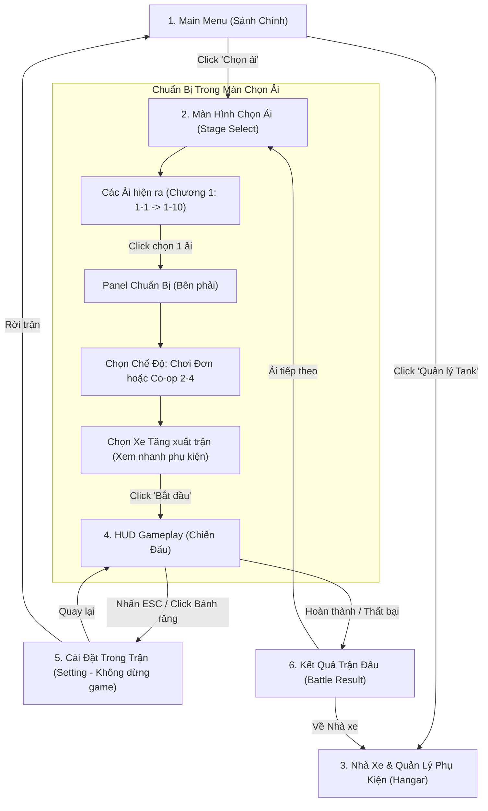

# TÀI LIỆU ĐẶC TẢ BỐ CỤC GIAO DIỆN GAME (UI/UX LAYOUT SPECIFICATION)
**Dự án:** Iron Wasteland (Top-Down 2D Action Shooter)  
**Người phụ trách:** Quốc Khánh  
**Trạng thái:** Chuẩn hóa toàn diện theo luồng tương tác: `MainMenu ➔ Chọn ải ➔ Chọn chế độ & Tank ➔ In-Game Setting & Combat`

---

## I. LUỒNG ĐIỀU HƯỚNG TRẢI NGHIỆM (USER INTERACTION FLOW)

---

## II. ĐẶC TẢ CHI TIẾT 6 MÀN HÌNH WIREFRAME (KÉO THẢ VÀO FIGMA)

Tất cả các file Vector SVG đã được cập nhật tại thư mục:  
📁 **[`d:\GameUnity\IronWasteland\docs\figma_wireframes\`](file:///d:/GameUnity/IronWasteland/docs/figma_wireframes/)**

---

### 1. Sảnh Chính / Menu Chính (`01_MainMenu_Wireframe.svg`)
* **Vị trí & Bố cục:**
  * **Góc trên cùng:** Logo game `IRON WASTELAND`, version tag, số lượng `Ngọc Ma Pháp 💎: 125`.
  * **Cụm 4 nút điều hướng bên Trái:**
    1. **"⚔ CHỌN ẢI (MÀN CHƠI)"** (Nút Primary màu xanh nổi bật) $\rightarrow$ Mở màn hình chọn ải.
    2. **"🛡 QUẢN LÝ TANK & PHỤ KIỆN"** $\rightarrow$ Mở Hangar nâng cấp xe & phụ kiện.
    3. **"⚙ CÀI ĐẶT (SETTINGS)"** $\rightarrow$ Mở cài đặt âm thanh, đồ họa chung.
    4. **"THOÁT GAME"** $\rightarrow$ Thoát ứng dụng.
  * **Khung bên Phải:** Khung 3D/2D Showcase xe tăng đang chọn (Wall Titan / Black Shadow / Red Nova) kèm thẻ tóm tắt vai trò và phụ kiện đang gắn.

---

### 2. Màn Hình Chọn Màn Chơi & Chuẩn Bị (`02_StageSelect_Wireframe.svg`)
*Đúng 100% yêu cầu: "MainMenu -> Chọn màn chơi - Các ải hiện ra -> Chọn một ải -> Chọn Chế độ, Chọn Tank -> Bắt đầu trận chiến"*
* **Vị trí & Bố cục:**
  * **Top Bar:** Nút `< VỀ SẢNH` + Tab chuyển đổi giữa **Chương 1 (Lục Địa Đen - 10 màn)** và **Chương 2 (Vùng Đất Nguyên Tố - 15 màn)**.
  * **Khu vực Trái & Giữa (Bản đồ tiến trình các Ải):**
    * Các ải hiển thị trực quan theo dạng lưới/nút liên kết:
      * **Ải đã qua (1-1, 1-2):** Đánh dấu tích xanh `✓`.
      * **Ải đang chọn (1-3):** Viền sáng xanh dương nổi bật kèm nhãn `[ĐANG CHỌN]`.
      * **Màn Boss cố định (Ải 1-5 & Ải 1-10):** Khung viền đỏ đặc trưng, ghi rõ tên Boss: *Boss Ải 1-5 The2Face* và *Đại Boss Ải 1-10 D1onk*.
  * **Panel Bên Phải (Chuẩn bị trận chiến cho ải được chọn):**
    * **Thông tin Ải:** Tên ải, mục tiêu, phần thưởng (Ngọc Ma Pháp + Tỷ lệ % rơi phụ kiện).
    * **Bước 1 — Chọn Chế Độ:** 
      * Tab `[ CHƠI ĐƠN (SOLO) ]`
      * Tab `[ CO-OP (2 - 4 NGƯỜI) ]`: Hiện phòng sảnh chờ Co-op với 4 slot người chơi (P1 Host, P2 Sẵn sàng, P3 & P4 đang chờ).
    * **Bước 2 — Chọn Xe Tăng:** 
      * Thẻ xe tăng mang vào trận (hiển thị nhanh Avatar xe, Cấp độ 1-90, vai trò, Phụ kiện đang gắn và hiệu ứng Passive).
      * Nút `[ĐỔI XE >]` để đổi nhanh qua xe khác (Wall Titan, Red Nova, Black Shadow).
    * **Bước 3 — Bắt đầu:** Nút lớn màu xanh lá **"BẮT ĐẦU TRẬN CHIẾN ➔"**.

---

### 3. Nhà Xe & Quản Lý Phụ Kiện (`03_Garage_Equipment_Wireframe.svg`)
* **Panel Trái:** Danh sách xe tăng mở khóa theo tiến trình.
* **Khu vực Giữa:**
  * Mô hình xe + Thanh cấp độ `Lv. 1 / 90` + Nút `NÂNG CẤP (5 💎)`.
  * Khung thiết lập kỹ năng: Kỹ năng thường, Kỹ năng chuyên biệt, và **2 nút chọn Kỹ năng tùy chọn 1 & 2**.
* **Panel Phải:**
  * **Bảng 8 chỉ số chuẩn hóa** (ATK, Max HP, Max Energy, DEF flat, Tốc độ, Giảm CD %, Tỉ lệ sát thương %, Xuyên giáp %).
  * **1 Ô PHỤ KIỆN DUY NHẤT:** Thẻ phụ kiện hiển thị Chỉ số cộng + Kỹ năng bị động Passive.
  * **2 Nút thao tác:** `[ĐỔI PHỤ KIỆN]` và `[PHÂN RÃ (8-12 💎)]`.

---

### 4. HUD Chiến Đấu Trong Gameplay (`04_GameplayHUD_Wireframe.svg`)
* **Góc trên-trái:** Avatar Tank, Thanh HP (xanh lá), Thanh Năng Lượng (xanh dương), Icon Passive của phụ kiện.
* **Góc trên-giữa:** Tracker ải (Đợt 2/3), Thanh Boss hiển thị cả Mạch Năng Lượng hộ thể tím + Máu đỏ.
* **Góc trên-phải:** 
  * Radar quét quái 200m.
  * **Nút Cài Đặt (Icon bánh răng ⚙ + Hotkey ESC):** Đổi tên từ "Pause" thành "Setting" để người chơi biết game không tạm dừng.
* **Góc dưới-trái:** Thanh máu rút gọn của đồng đội Co-op (P2, P3, P4).
* **Góc dưới-phải:** Cụm 4 phím kỹ năng:
  * Phím J (Thường - đánh trúng hồi năng lượng).
  * Phím K (Chuyên biệt - đếm số giây hồi CD).
  * Phím L (Kỹ năng tùy chọn 1).
  * Phím I (Kỹ năng tùy chọn 2).

---

### 5. Popup Cài Đặt Trong Trận (`05_InGame_Settings_Wireframe.svg`)
*Đúng yêu cầu: "Vì có Coop nên trận đấu không thể dừng, đổi tên thành Setting thôi"*
* **Lớp phủ nền (Overlay):** Phủ mờ 75%, người chơi vẫn nhìn thấy xe quái và đồng đội đang di chuyển phía sau.
* **Hộp thoại Cài Đặt ở giữa:**
  * **Hộp cảnh báo (Alert Banner):** *"⚠️ CHÚ Ý: GAME KHÔNG TẠM DỪNG! Trận đấu hỗ trợ Co-op mạng nên quái và đồng đội vẫn đang chiến đấu."*
  * **Thanh trượt Master Volume & SFX âm thanh ma pháp.**
  * **Bảng nhắc phím:** WASD (Di chuyển), Chuột (Ngắm), J/K/L/I (Kỹ năng), ESC (Đóng mở Setting).
  * **Nút 1 (Primary):** "QUAY LẠI TRẬN CHIẾN (ESC)".
  * **Nút 2 (Danger):** "RỜI TRẬN (VỀ SẢNH CHÍNH)" kèm ghi chú: *Nếu chơi Co-op sẽ rời khỏi phòng đồng đội.*

---

### 6. Kết Quả Trận Đấu (`06_BattleResult_Wireframe.svg`)
* **Thống kê:** Kẻ địch diệt, Tổng sát thương, Thời gian hoàn thành, % Máu còn lại.
* **Tiến trình:** Thanh kinh nghiệm xe tăng hướng đến mốc cấp tiếp theo.
* **Chiến lợi phẩm (Loot):** Nhận **Ngọc Ma Pháp 💎**, **Rơi Phụ Kiện ngẫu nhiên**, và mảnh xe tăng mới.
* **2 Nút điều hướng:** `[ VỀ NHÀ XE ]` hoặc `[ ẢI TIẾP THEO ➔ ]`.
